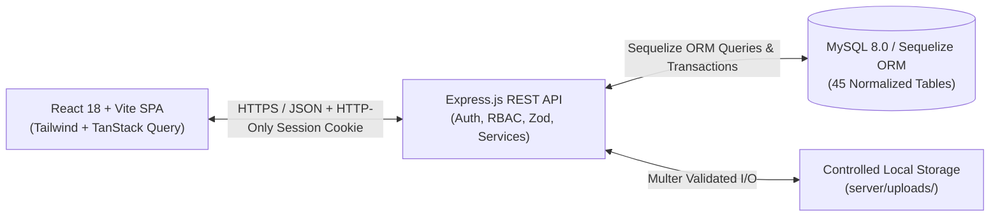

# System Architecture & Database Schema

## 1. High-Level Architecture

The platform is engineered with a strict three-tier separation of concerns:

1. **Presentation Layer (`client/`)**:
   - Single-Page Application (SPA) built with React 18, Vite, Tailwind CSS, React Router v6, and TanStack Query.
   - Communicates exclusively with the backend REST API (`/api/v1/*`) using HTTP-only session cookies (`withCredentials: true`).
   - Zero database credentials, secrets, or business authorization bypasses exist in the client bundle.
2. **Application & Domain Layer (`server/`)**:
   - **Controllers (`server/src/controllers/`)**: Handle HTTP transport concerns, pagination, filtering, and response envelopes.
   - **Services (`server/src/services/`)**:
     - `gradebook.service.js`: Computes weighted category averages (`Assignments`, `Quizzes`, `Examinations`, `Labs & Practicals`), maps percentage scores to institutional letter grades (`A` through `F`) and GPA points, and writes immutable `grade_history` audit entries on every grade mutation.
     - `progress.service.js`: Recalculates per-student module and course completion percentages whenever lessons, assignments, or assessments are completed, and automatically issues verifiable completion certificates (`CERT-YYYY-XXXXXXXX`) when completion reaches 100% with a passing score.
   - **Middleware (`server/src/middleware/`)**:
     - `auth.middleware.js`: Enforces session authentication (`requireAuth`), role checks (`requireRoles`), granular permission verification (`requirePermissions`), and class-level scope verification (`verifyClassAccess`).
     - `upload.middleware.js`: Enforces file size limits, extension/MIME whitelisting, and cryptographic UUID filenames.
     - `error.middleware.js`: Normalizes Zod validation errors, Sequelize constraint errors, and operational exceptions into consistent JSON error responses.
3. **Persistence Layer (`server/src/models/`, `server/src/migrations/`)**:
   - 45 normalized relational tables managed via Sequelize migrations and foreign-key constraints.

---

## 2. Complete 45-Table Relational Schema

### Domain 1: Identity, Access Management & Governance (`iam.models.js`)
1. `users`: Institutional accounts (`email`, `password_hash`, `first_name`, `last_name`, `student_number`, `employee_number`, `status`, `failed_login_attempts`, `locked_until`, `notification_preferences`).
2. `roles`: System and custom roles (`super_admin`, `academic_admin`, `instructor`, `teaching_assistant`, `student`).
3. `permissions`: Granular permission slugs (`users.manage`, `academic.manage`, `grades.approve`, etc.).
4. `role_permissions`: Many-to-many join mapping roles to permissions.
5. `user_roles`: Many-to-many join mapping users to assigned roles with audit metadata.
6. `system_settings`: Key-value JSON store for institution-wide configuration, grading scales, security policies, and maintenance state.
7. `audit_logs`: Tamper-evident record of sensitive operations (`actor_id`, `action`, `entity_type`, `entity_id`, `severity`, `ip_address`, `metadata`).

### Domain 2: Academic Hierarchy & Enrollment (`academic.models.js`)
8. `institutions`: Root institutional record (`name`, `code`, `domain`, `timezone`).
9. `departments`: Academic faculties/departments (`code`, `name`, `head_name`).
10. `programs`: Degree or certification tracks (`code`, `name`, `degree_type`, `total_credits`).
11. `academic_years`: Institutional academic years (`name`, `start_date`, `end_date`, `is_current`).
12. `semesters`: Academic terms (`name`, `code`, `start_date`, `end_date`, `enrollment_start`, `enrollment_end`, `status`).
13. `courses`: Master course catalog entries (`code`, `title`, `description`, `credit_units`, `level`, `delivery_mode`, `category`, `passing_grade`, `prerequisites_json`).
14. `course_offerings`: Term-specific instances of courses (`course_id`, `semester_id`, `max_sections`, `status`).
15. `classes`: Individual class sections (`section_code`, `title`, `schedule_text`, `room`, `delivery_mode`, `capacity`, `enrolled_count`, `final_grades_status`).
16. `instructor_assignments`: Maps instructors to class sections (`class_id`, `instructor_id`, `is_primary`).
17. `teaching_assistant_assignments`: Maps TAs to class sections with granular flags (`can_grade_preliminary`, `can_manage_discussions`).
18. `class_memberships`: Student enrollments (`class_id`, `student_id`, `status`, `enrolled_at`, `final_percentage`, `final_letter_grade`, `final_grade_approved`).

### Domain 3: Curriculum Delivery & Progress Tracking (`content.models.js`)
19. `modules`: Ordered course/class learning modules (`title`, `description`, `sequence_order`, `is_published`, `unlock_at`, `completion_rule`).
20. `lessons`: Individual learning units supporting rich Markdown, embedded video, interactive CLI/code sandboxes, and networking topology guides (`content_type`, `content_body`, `estimated_minutes`, `is_published`).
21. `learning_resources`: Downloadable attachments, Packet Tracer `.pka` topologies, RFC PDFs, and reference links (`resource_type`, `file_url`, `file_name`, `file_size`).
22. `lesson_progress`: Per-student lesson tracking (`status`, `time_spent_seconds`, `last_accessed_at`, `completed_at`).
23. `course_progress`: Aggregated per-student class progress (`completed_lessons_count`, `total_lessons_count`, `completed_assignments_count`, `completed_assessments_count`, `overall_progress_percent`, `last_lesson_id`).

### Domain 4: Assignments, Rubrics & Examinations (`assessment.models.js`)
24. `assignments`: Coursework and technical laboratory tasks (`title`, `instructions`, `submission_type`, `programming_language`, `starter_code`, `max_points`, `due_at`, `late_policy`, `late_penalty_percent`, `max_attempts`, `is_published`).
25. `assignment_attachments`: Instructor reference files attached to assignments.
26. `grading_rubrics`: Structured rubrics linked to assignments (`title`, `total_points`).
27. `rubric_criteria`: Individual rubric evaluation rows (`criterion_name`, `description`, `max_points`, `weight_percent`).
28. `submissions`: Student assignment submissions (`attempt_number`, `status`, `text_entry`, `code_snippet`, `programming_language`, `file_url`, `is_late`, `preliminary_score`, `preliminary_feedback`, `flagged_for_review`, `flag_reason`, `rubric_scores_json`).
29. `submission_versions`: Historical snapshots of every student submission attempt/resubmission.
30. `question_banks`: Reusable pools of assessment questions organized by course and topic (`title`, `category`, `difficulty`).
31. `questions`: Assessment items supporting 8 types: `multiple_choice`, `multiple_select`, `true_false`, `short_answer`, `essay`, `matching`, `fill_blank`, and `code_practical`.
32. `question_options`: Choices, matching pairs, and accepted answer keys for questions.
33. `assessments`: Quizzes, module exams, and final examinations (`assessment_type`, `time_limit_minutes`, `max_attempts`, `passing_score_percent`, `shuffle_questions`, `show_results_immediately`, `is_published`).
34. `assessment_questions`: Ordered join linking questions to an assessment with point overrides.
35. `assessment_attempts`: Server-timed student exam attempts (`attempt_number`, `status`, `started_at`, `expires_at`, `submitted_at`, `auto_score`, `manual_score`, `total_score`, `percentage`, `passed`).
36. `assessment_answers`: Individual student responses per question with auto-grading and instructor feedback fields.

### Domain 5: Gradebook, Audit History & Certificates (`grading.models.js`)
37. `grade_categories`: Weighted grading buckets per class (`name`, `weight_percent`, `drop_lowest`).
38. `grades`: Unified gradebook entries linking a student, class, category, and source item (`assignment` or `assessment`) with `raw_score`, `late_penalty_deducted`, `final_score`, `max_points`, `percentage`, `letter_grade`, `status`, and `is_locked`.
39. `grade_history`: Immutable audit log recording every score creation, TA preliminary evaluation, instructor override, or registrar lock (`previous_score`, `new_score`, `changed_by`, `reason`).
40. `certificates`: Verifiable completion credentials (`certificate_number`, `verification_code`, `final_score`, `issued_at`, `revoked_at`).

### Domain 6: Communication & Notifications (`communication.models.js`)
41. `announcements`: Institution-wide, department-wide, or class-specific announcements (`scope`, `priority`, `is_pinned`).
42. `discussions`: Class discussion forums (`title`, `description`, `is_pinned`, `is_locked`).
43. `discussion_posts`: Threaded forum posts and replies (`parent_post_id`, `body`, `is_instructor_endorsed`).
44. `conversations`, `conversation_members`, `messages`: Direct academic messaging between students, TAs, and instructors.
45. `notifications`: In-app notification inbox items (`type`, `title`, `message`, `link_url`, `is_read`).

---

## 3. Defense-in-Depth Security Controls

1. **Password Hashing**: Uses Argon2id (`argon2.argon2id`) with memory cost 19456 KiB, time cost 2, and parallelism 1.
2. **Brute-Force & Account Lockout Protection**: Tracks failed login attempts per user and automatically locks accounts after 5 consecutive failures for 15 minutes (`locked_until`), recording a `warning` security event in `audit_logs`.
3. **Centralized RBAC & Resource-Scope Verification**:
   - Every protected route passes through `requireAuth` and `requireRoles`/`requirePermissions`.
   - Class-scoped endpoints invoke `verifyClassAccess`, confirming that an Instructor or TA is assigned to that specific class or a Student has an active enrollment in that class.
   - Students querying grades, submissions, or exam attempts are strictly bound to `req.user.id` on the server—preventing Horizontal Privilege Escalation (IDOR).
4. **Privilege Escalation Prevention**:
   - Users cannot modify their own roles or deactivate their own Super Admin account.
   - Teaching Assistants are blocked from publishing final grades, modifying course structure, or altering assessment configurations.
   - Super Administrators are restricted from arbitrarily changing student grades without following the auditable gradebook workflow.

