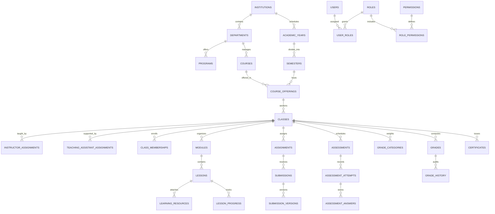

# Database Design & Relational Schema (`45` Tables)

The persistence layer is built on **Sequelize ORM v6** and **MySQL 8.0** (with automatic local SQLite compatibility for zero-daemon development and testing). All schema definitions are managed via [`20261028000001-create-lms-schema.js`](file:///c:/Users/Ryan/Desktop/LMS/server/src/migrations/20261028000001-create-lms-schema.js) and seeded via [`20261028000001-seed-initial-data.js`](file:///c:/Users/Ryan/Desktop/LMS/server/src/seeders/20261028000001-seed-initial-data.js).

---

## 1. Entity-Relationship Overview

---

## 2. Normalized Table Inventory (`45` Tables)

### 2.1 Identity, Access Control & Governance ([`iam.models.js`](file:///c:/Users/Ryan/Desktop/LMS/server/src/models/iam.models.js))
1. `users`: Stores institutional accounts (`email` unique, `password_hash` Argon2id, `status`, `failed_login_attempts`, `locked_until`, `password_reset_token`, `password_reset_expires`, `notification_preferences`).
2. `roles`: Stores the 5 primary system roles (`super_admin`, `academic_admin`, `instructor`, `teaching_assistant`, `student`).
3. `permissions`: Stores 36 granular permission codes (`users:read`, `users:write`, `roles:manage`, `grades:approve`, etc.).
4. `role_permissions`: Composite mapping between `roles` and `permissions`.
5. `user_roles`: Composite mapping between `users` and `roles`, tracking `assigned_by`.
6. `system_settings`: Key-value configuration store for security policies, file upload limits, and grading templates.
7. `audit_logs`: Immutable security and operational audit log (`actor_id`, `actor_email`, `actor_role`, `action`, `category`, `severity`, `entity_type`, `entity_id`, `ip_address`, `metadata`).
8. `user_sessions`: Persistent session store managed by `connect-session-sequelize`.

### 2.2 Academic Hierarchy & Enrollment ([`academic.models.js`](file:///c:/Users/Ryan/Desktop/LMS/server/src/models/academic.models.js))
9. `institutions`: Root institutional configuration and default grading scale.
10. `departments`: Academic departments (`code` unique, `name`, `head_name`, `status`).
11. `programs`: Degree programs linked to departments (`code` unique, `name`, `degree_type`, `duration_years`).
12. `academic_years`: Academic calendar years (`name`, `start_date`, `end_date`, `is_current`).
13. `semesters`: Academic terms linked to academic years (`code` unique, `enrollment_start_date`, `enrollment_end_date`, `is_current`).
14. `courses`: Reusable catalog subjects (`code` unique, `title`, `description`, `credit_units`, `level`, `delivery_mode`, `publication_status`).
15. `course_offerings`: Term-specific course instances linking `courses` and `semesters`.
16. `classes` (`ClassSection`): Individual class sections (`section_code` unique, `capacity`, `enrolled_count`, `final_grades_status`).
17. `instructor_assignments`: Assigns instructors to class sections (`class_id`, `instructor_id`, `is_primary`).
18. `teaching_assistant_assignments`: Assigns TAs to class sections with granular flags (`can_review_submissions`, `can_enter_preliminary_scores`, `can_moderate_discussions`, `can_assist_labs`).
19. `class_memberships`: Student enrollments (`class_id`, `student_id`, `status`, `final_percentage`, `final_letter_grade`, `final_grade_status`).

### 2.3 Learning Content & Progress ([`content.models.js`](file:///c:/Users/Ryan/Desktop/LMS/server/src/models/content.models.js))
20. `modules`: Ordered course/class modules (`title`, `sequence_order`, `is_published`, `unlock_at`).
21. `lessons`: Learning units inside modules (`title`, `content_type`, `content_html`, `lab_instructions`, `estimated_minutes`, `is_published`).
22. `learning_resources`: Downloadable files and links attached to modules/lessons (`resource_type`, `file_path`, `file_name`, `mime_type`, `file_size_bytes`).
23. `lesson_progress`: Per-student lesson completion tracking (`status`, `time_spent_seconds`, `completed_at`).
24. `course_progress`: Aggregated per-student class completion metrics (`completed_lessons_count`, `total_lessons_count`, `progress_percentage`, `last_accessed_lesson_id`).

### 2.4 Assignments, Rubrics & Examinations ([`assessment.models.js`](file:///c:/Users/Ryan/Desktop/LMS/server/src/models/assessment.models.js))
25. `assignments`: Coursework and laboratory tasks (`title`, `instructions`, `submission_type`, `max_score`, `due_date`, `late_submission_policy`, `late_penalty_percent`, `max_attempts`, `is_published`).
26. `assignment_attachments`: Reference files attached to assignments.
27. `grading_rubrics`: Structured evaluation rubrics linked to assignments.
28. `rubric_criteria`: Individual rubric rows (`criterion_title`, `max_points`, `weight_percent`).
29. `submissions`: Student assignment submissions (`attempt_number`, `status`, `submission_text`, `code_submission`, `file_path`, `is_late`, `score`, `feedback`, `preliminary_score`, `preliminary_feedback`, `flagged_for_instructor_review`, `flag_reason`).
30. `submission_versions`: Immutable historical snapshots of each submission attempt.
31. `question_banks`: Reusable pools of assessment questions.
32. `questions`: Assessment questions supporting `multiple_choice`, `multiple_select`, `true_false`, `short_answer`, `essay`, `matching`, `fill_blank`, and `code_practical`.
33. `question_options`: Choices and answer keys for questions.
34. `assessments`: Timed quizzes, module exams, and final examinations (`assessment_type`, `time_limit_minutes`, `max_attempts`, `passing_score`, `shuffle_questions`, `is_published`).
35. `assessment_questions`: Ordered join linking questions to assessments.
36. `assessment_attempts`: Server-timed student attempts (`attempt_number`, `status`, `started_at`, `expires_at`, `submitted_at`, `auto_score`, `manual_score`, `total_score`, `percentage`).
37. `assessment_answers`: Student responses per question during an attempt.

### 2.5 Gradebook, History & Certificates ([`grading.models.js`](file:///c:/Users/Ryan/Desktop/LMS/server/src/models/grading.models.js))
38. `grade_categories`: Weighted grading buckets per class (`name`, `category_type`, `weight_percent`).
39. `grades`: Unified gradebook records (`student_id`, `class_id`, `category_id`, `raw_score`, `final_score`, `max_score`, `percentage`, `letter_grade`, `status`, `is_locked`).
40. `grade_history`: Immutable audit log of every score creation, override, or lock (`previous_score`, `new_score`, `changed_by`, `reason`).
41. `certificates`: Verifiable completion credentials (`certificate_number`, `verification_code` unique, `final_grade_percent`, `issued_at`, `status`).

### 2.6 Communication & Notifications ([`communication.models.js`](file:///c:/Users/Ryan/Desktop/LMS/server/src/models/communication.models.js))
42. `announcements`: Institutional, department, and class announcements.
43. `discussions`: Class discussion threads (`title`, `category`, `is_pinned`, `is_resolved`, `escalated_to_instructor`).
44. `discussion_posts`: Threaded replies (`discussion_id`, `author_id`, `content`, `is_endorsed_answer`).
45. `conversations`, `conversation_members`, `messages`, `notifications`: Direct messaging and in-app notification persistence.

---

## 3. Database Integrity & Transaction Rules

1. **Multi-Step Transactions**: Operations that modify multiple tables (user + role creation, student section transfers, CSV bulk imports, submission grading + gradebook recalculation, final grade approval + grade locking) execute inside `sequelize.transaction()` blocks with automatic rollback on error.
2. **Referenced Record Protection**: Deleting a Department that has associated Courses or Programs is blocked with `409 REFERENCED_RECORD_PROTECTED`.
3. **Unique & Capacity Constraints**: Duplicate student enrollments in the same class section are blocked with `409 DUPLICATE_ENROLLMENT`.

