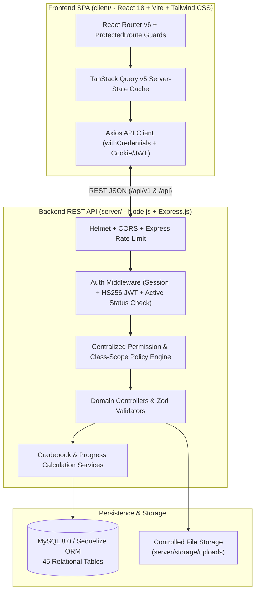

# System Architecture & Security Model

## 1. Architectural Overview

The Aetheria Institute & Networking Academy LMS uses a decoupled three-tier architecture:

---

## 2. Centralized Role-Based Permission Matrix

All permissions are stored in the database (`permissions` and `role_permissions`) and enforced on the server by `requireRole`, `requirePermission`, and `verifyClassAccess` in [`server/src/middleware/auth.middleware.js`](file:///c:/Users/Ryan/Desktop/LMS/server/src/middleware/auth.middleware.js).

| Functionality | Super Admin | Academic Admin | Instructor | Teaching Assistant | Student |
| :--- | :---: | :---: | :---: | :---: | :---: |
| **Manage system settings (`settings:manage`)** | Yes | No | No | No | No |
| **Manage all users (`users:write`)** | Yes | Limited academic scope | No | No | No |
| **Assign system roles (`roles:manage`)** | Yes | No | No | No | No |
| **Manage departments (`departments:manage`)** | Yes | Yes | No | No | No |
| **Manage academic programs (`programs:manage`)** | Yes | Yes | No | No | No |
| **Manage academic periods (`terms:manage`)** | Yes | Yes | No | No | No |
| **Create class sections (`classes:manage`)** | Yes | Yes | No | No | No |
| **Assign instructors & TAs (`classes:manage`)** | Yes | Yes | No | No | No |
| **Manage assigned course content (`content:manage`)** | Oversight | Oversight | Yes (Assigned) | View Only | No |
| **Create assignments (`assignments:manage`)** | No | No | Yes (Assigned) | No | No |
| **Submit assignments (`assignments:submit`)** | No | No | No | No | Yes (Enrolled) |
| **Review submissions (`submissions:review`)** | Oversight | Oversight | Yes (Assigned) | Yes (Assigned) | Own Only |
| **Enter preliminary grades & flags** | No | No | Yes (Assigned) | Yes (If delegated) | No |
| **Finalize official grades (`submissions:grade`)** | No | No | Yes (Assigned) | **Blocked (`403`)** | No |
| **Approve final class grades (`grades:approve`)** | No | Yes | No | No | No |
| **Create assessments (`assessments:manage`)** | No | No | Yes (Assigned) | No | No |
| **Take assessments (`assessments:take`)** | No | No | No | No | Yes (Enrolled) |
| **Export reports (`reports:export`)** | Yes | Yes | Assigned Classes | No | **Blocked (`403`)** |
| **View audit logs (`audit:read`)** | Yes | No | **Blocked (`403`)** | No | **Blocked (`403`)** |

---

## 3. Security Architecture

1. **Authentication & Token Strategy**:
   - Passwords are hashed using **Argon2id** (`memoryCost: 19456`, `timeCost: 2`, `parallelism: 1`).
   - Authentication supports both **Server-Side Sessions (`lms.sid`)** backed by Sequelize and **Signed HS256 JWT Tokens (`lms.jwt` HttpOnly cookie + `Authorization: Bearer` header)**.
   - Every authenticated request verifies the user's live database status (`user.status === 'active'`), ensuring deactivated or suspended accounts lose access immediately.
2. **Resource-Level Scope Isolation (`verifyClassAccess`)**:
   - Instructors and Teaching Assistants can only access or grade class sections to which they are explicitly assigned.
   - Students can only access lessons, assignments, quizzes, and grade rows belonging to their own enrollments and their own `req.user.id`.
3. **XSS & Upload Hardening**:
   - Rich lesson and announcement HTML is sanitized via [`server/src/utils/sanitizer.js`](file:///c:/Users/Ryan/Desktop/LMS/server/src/utils/sanitizer.js) to strip `<script>`, `<iframe>`, `javascript:` URLs, and inline `on*=` event handlers.
   - File uploads via Multer ([`server/src/middleware/upload.middleware.js`](file:///c:/Users/Ryan/Desktop/LMS/server/src/middleware/upload.middleware.js)) enforce a strict extension whitelist and reject executable files.
4. **Academic Integrity & Answer Key Protection**:
   - Starting or resuming a quiz attempt (`POST /api/v1/assessments/:id/start`) strips `isCorrect` and `correctAnswerText` from all question options before sending the payload to the client.
   - Attempt deadlines are enforced using server timestamps (`expiresAt`).

